# PinForGPT

**Keep your favorite ChatGPT conversations within reach — and make them easier to recognize.**

PinForGPT is a free-standing, unofficial browser extension that adds a **separate Favorites section** to the ChatGPT sidebar. Save important conversations, return to them quickly, and manage the same list from a convenient extension popup — even when you're not on the ChatGPT website.

**[Download the latest release](https://github.com/TheOnefor/PinForGPT/releases/latest)** · [What it does](#features-at-a-glance) · [Installation](#6-installing-pinforgpt-for-the-first-time) · [Updating](#7-updating-pinforgpt-without-losing-favorites)

> [!IMPORTANT]
> **ChatGPT can change without notice.** PinForGPT integrates with parts of the ChatGPT interface that OpenAI may redesign at any time. A site update could temporarily break the Favorites section, the chat-menu action, or the way custom icons are displayed. As an independent project, PinForGPT cannot guarantee immediate fixes.
>
> **Your saved Favorites are not tied to those visual elements.** The extension popup reads the saved list from Chrome's local extension storage and can generally still open your favorite chat links even if the ChatGPT sidebar integration temporarily stops working. This fallback is not a guarantee against every possible browser, account, URL, or extension failure. **Export a JSON backup periodically.**

## Read this first

- **New to PinForGPT?** Start with the [step-by-step installation guide](#6-installing-pinforgpt-for-the-first-time). Already using it? Follow the [update guide](#7-updating-pinforgpt-without-losing-favorites) **and export a backup before replacing any files**.
- **What is the main feature?** PinForGPT creates its **own Favorites collection** alongside ChatGPT's built-in pinned chats. Your saved chats are also available from the [extension popup](#2-the-popup-your-favorites-wherever-you-are), which you can open from the Chrome toolbar.
- **How many Favorites can you save?** There is **no fixed chat-count limit built into PinForGPT**. Practical limits still apply, such as Chrome's local extension storage quota and browser performance; this is not unlimited cloud storage.
- **What if ChatGPT changes its interface?** The sidebar and in-page features may stop working temporarily. Your existing Favorites can generally still be accessed through the popup. See the [compatibility notes](#5-compatibility-privacy-and-known-limitations).

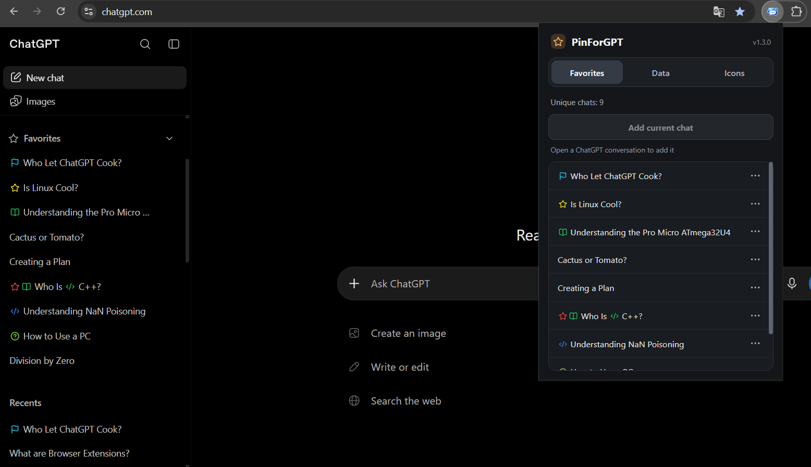

*PinForGPT is not affiliated with, endorsed by, or maintained by OpenAI.*

## Features at a glance

| Feature | What you get |
| --- | --- |
| **Separate Favorites** | A collapsible list in the ChatGPT sidebar, independent of ChatGPT's built-in pinned chats. |
| **No fixed chat-count cap** | Save as many Favorites as practical; Chrome local storage limits and browser performance still apply. |
| **Quick access from the popup** | View and open saved chats from anywhere in Chrome, without first navigating to ChatGPT. |
| **Easy add and remove** | Use the chat's native `…` menu, the Favorites section's own menu, or the popup when appropriate. |
| **Recognize the active chat** | Your currently open favorite is highlighted in the sidebar. |
| **Custom title icons** | Decorate chat names with **55 built-in Lucide icons** and **19 colors**, using short text codes. |
| **Automatic title updates** | Changes to a favorite's name made in ChatGPT are reflected in Favorites when detected. |
| **Portable backups** | Export a readable JSON file; import it using **Merge** or **Replace**. |
| **Language support** | English and Ukrainian interface text, based on your browser/page language. |
| **Regular and project chats** | Favorite and open supported conversations, including chats inside ChatGPT Projects. |

## 1. Favorites: the main feature

PinForGPT's purpose is simple: **give you your own dedicated collection of important conversations**.

ChatGPT has its own organizational features, including pinned chats. PinForGPT does **not** replace them, change their order, or synchronize with them. It adds a **different Favorites collection** that you control through the extension.

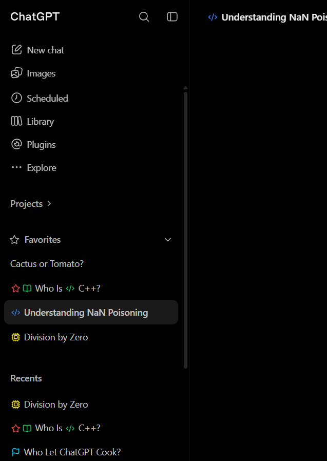

### Is there a limit to the number of Favorites?

PinForGPT does **not** impose an arbitrary maximum number of saved chats. You can keep adding Favorites instead of managing a small fixed set of slots. However, the list is stored in **Chrome's local extension storage**, which has storage quotas and practical performance limits. The exact number you can save is therefore **not guaranteed to be unlimited**. Keep periodic JSON backups of important entries.

### Add a chat to Favorites

1. Open ChatGPT and find the conversation you want to save.
2. Open that chat's **`…` (more actions)** menu.
3. Choose **Add to favorites** (the PinForGPT action).
4. Open the **Favorites** section in the sidebar to find your saved conversation.

To remove it, open the menu again and choose **Remove from favorites**. You can also remove saved chats using the menu beside an item in the Favorites section or in the popup.

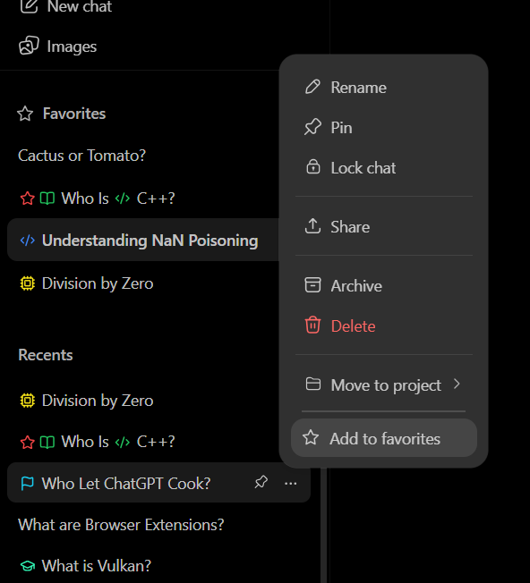

**Removing a favorite does not delete its ChatGPT conversation.** It only removes that chat from PinForGPT's list. Likewise, adding a favorite does not pin it using ChatGPT's built-in pinning feature.

### Navigate your saved conversations

- Click a favorite in the sidebar to open that conversation.
- Expand or collapse the Favorites section whenever you like.
- The current conversation is highlighted when it is in Favorites.
- Favorite chat titles update when PinForGPT detects a rename performed through ChatGPT.
- Conversations inside ChatGPT Projects can also be saved and opened by their supported chat URLs.

### Automatic title synchronization

When you rename a conversation in ChatGPT, PinForGPT can
automatically update its saved title in Favorites.

- Changes are detected from conversation titles loaded in
  ChatGPT's interface.
- Updated names appear in the Favorites sidebar and popup.
- Synchronization is best-effort, not a background scan of
  all your ChatGPT conversations.
- Multiple open ChatGPT tabs may occasionally cause an older
  title to overwrite a newer one. Refreshing the affected
  tabs can help restore the correct title.

PinForGPT does not rename conversations in ChatGPT itself.
Use ChatGPT's native Rename action to change a conversation title.

## 2. The popup: your Favorites, wherever you are

Click the **PinForGPT icon** in the Chrome toolbar to open the popup. It has three tabs: **Favorites**, **Data**, and **Icons**.

The popup is useful precisely because it does not need to be inside ChatGPT's sidebar. You can be reading another website, open PinForGPT, and jump straight to a saved conversation.

### How to open the popup

A **popup** is the small PinForGPT window that opens from Chrome's toolbar; it is not a separate ChatGPT page. Once the extension is installed:

1. Click Chrome's **Extensions** button (the puzzle-piece icon next to the address bar).
2. Find **PinForGPT** in the extensions list and **click its name/icon** to open the popup.
3. **Optional but recommended:** click the **pin-shaped toolbar control** next to PinForGPT to keep its icon visible beside the address bar. Next time, you can click that icon directly to open the popup.

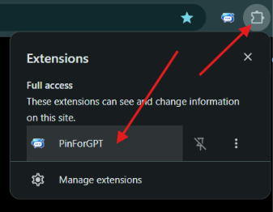

*The Extensions menu may look a little different depending on your Chrome version or language. Pinning the browser toolbar icon is separate from saving a ChatGPT conversation to Favorites.*

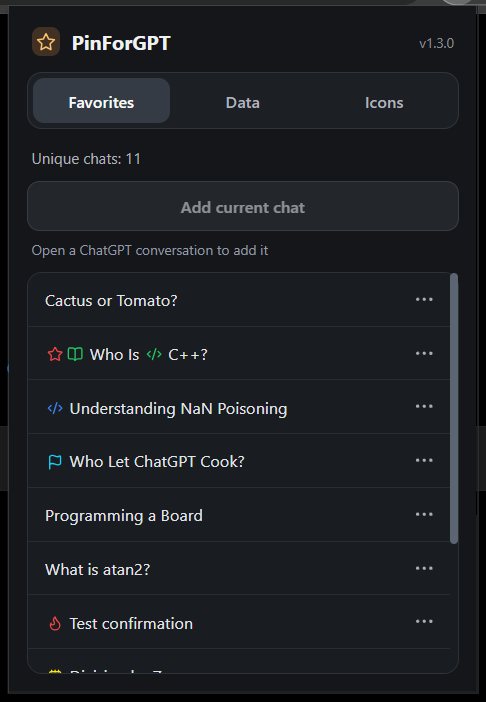

### Favorites tab

- See your saved conversations and the count of unique chats.
- **Click a saved conversation to open it in a new browser tab.** This is intentional: the popup does not reuse or replace your current tab.
- Remove a conversation using its `…` menu.
- When a supported ChatGPT conversation is the active browser tab, use **Add current chat** to save it. If you are on another website or a page without a supported chat URL, this action is unavailable; your existing Favorites remain accessible.

### Why use the popup instead of only the sidebar?

- **Available from the browser toolbar:** open Favorites while reading another site, without first loading ChatGPT.
- **Fast navigation:** jump to a saved chat in one click, always in a new tab, without losing your current page.
- **Less dependent on ChatGPT's changing HTML:** saved links are read from extension storage, so the popup can often continue working when native menu or sidebar integrations temporarily break.
- **One place to manage the collection:** view your list, remove entries, and add a supported currently open conversation.
- **Built-in utilities:** access JSON backups and the title-icon builder from the same small window.
- **No extra space required in ChatGPT:** the popup is available when you want it and closes when you are done.

The popup is a practical fallback, not a promise that all future changes to ChatGPT or Chrome will be harmless.

## 3. Back up and restore your Favorites

Favorites are stored using **Chrome's local extension storage** in your browser profile. They are not the same as ChatGPT's own account data. Keep a backup if the list matters to you — especially before updating or reinstalling the extension.

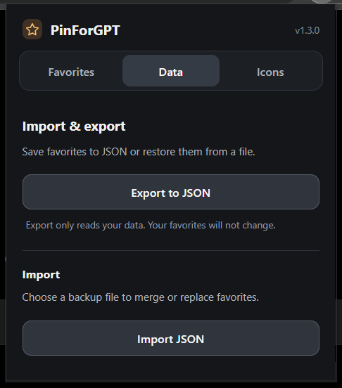

### Export a backup

1. Open PinForGPT's popup.
2. Select **Data**.
3. Click **Export to JSON**.
4. Keep the downloaded `.json` file somewhere safe.

A backup includes the saved chat titles, URLs, and ordering. If a title contains icon codes, those codes are preserved as ordinary title text. The export does **not** delete or modify your Favorites.

> [!CAUTION]
> **Backup files may contain private information.** Chat titles and conversation links can be sensitive. Do not upload your backup to a public repository or share it unless you intend to share those details.

### Import a backup

1. In the **Data** tab, click **Import JSON**.
2. On the import page, select a backup file or drag and drop it into the upload area.
3. Review the file summary before continuing.
4. Choose an import mode:
   - **Merge:** keep existing Favorites and append chats that are not already saved. Existing entries and titles are preserved.
   - **Replace:** discard the current Favorites list and replace it with the imported list.
5. Confirm the action only after checking the selection and mode.

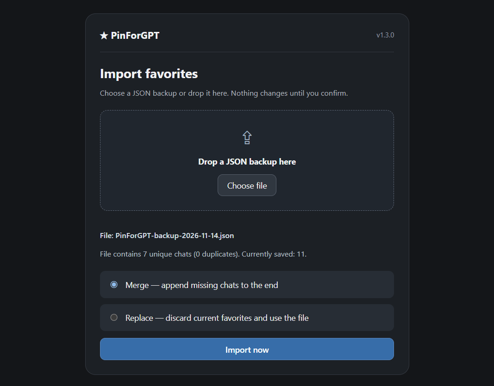

**Replace is destructive for the Favorites list.** Export your current data first. Neither import mode deletes the actual conversations from ChatGPT; they only change PinForGPT's saved list.

PinForGPT also supports certain older backup formats, but an exported backup from the current release is the recommended format.

## 4. Custom icons and colors for chat titles

**New in v1.3.0:** PinForGPT can visually decorate conversation titles using **55 icons** and **19 colors**. You can use them in normal conversations and supported project conversations.

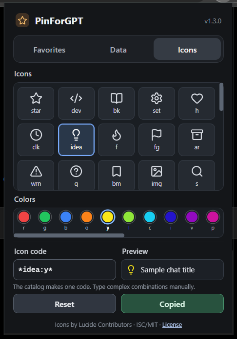

### Create a code in the Icons tab

1. Open the popup and select **Icons**.
2. Choose an icon from the scrollable grid.
3. Choose a color from the horizontal strip. Hover over a color to see its name and short code.
4. Look at the live preview and the generated code.
5. Click **Copy**.
6. Rename your ChatGPT conversation and paste the copied code into its title (usually at the beginning).
7. Save the name in ChatGPT. PinForGPT will then display the icon in supported title locations.

You can also type a valid code manually into the input field. The builder checks the syntax, shows a preview, and only allows copying when the code is valid. **Reset** clears the current selection and input.

### What icon codes look like

A single colored icon:

```text
*star:r* Important conversation
```

Three icons with three colors:

```text
*star,dev,bk:r,g,b* Programming notes
```

Several icons can share the last specified color:

```text
*star,dev,bk:r,g* Reference material
```

Multiple separate code groups can appear in the same title:

```text
*idea:y* Ideas and *bk:b* research
```

**Syntax in brief:** `*icon:color*` for one icon, or `*icon1,icon2:color1,color2*` for a sequence. When there are fewer colors than icons, the last color carries forward. Invalid or unknown codes remain visible as regular text rather than being silently removed.

The full list of available codes is shown in the **Icons** tab. No extra icon packs or network downloads are required: the Lucide SVGs are bundled with the extension.

### Where icons appear

PinForGPT renders title icons in four places:

1. The extension's **Favorites** section in the ChatGPT sidebar.
2. The popup's **Favorites** list.
3. Supported **native chat lists** in the ChatGPT sidebar.
4. The **header of the opened conversation**.

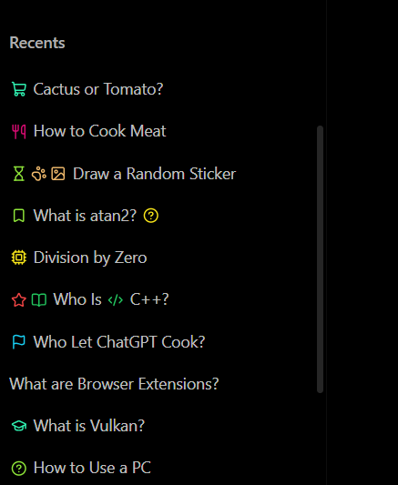

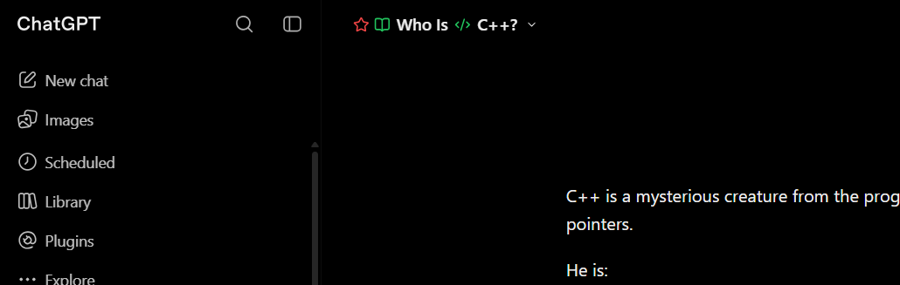

The original title is kept intact. If PinForGPT is disabled or its title renderer stops working after a ChatGPT update, the `*icon:color*` markers may appear as plain text. They have not been removed from your chat name.

### Why are icons added through chat names instead of a one-click rename button?

PinForGPT intentionally uses **text markers in the actual ChatGPT conversation title** rather than maintaining a separate database that only remembers which icon belongs to which chat. This keeps the icon choice attached to the title and lets PinForGPT display it consistently in different places. It also means exported Favorites retain the exact text needed to restore their appearance.

The extension **does not rename ChatGPT conversations for you**. Doing that automatically would mean relying on ChatGPT's internal/private rename mechanisms and potentially sensitive session credentials. We chose not to request or handle those credentials for this feature, or to depend on an undocumented operation that can change without warning.

Instead, use **ChatGPT's own Rename action** — either from the conversation's `…` menu in the chat list or from the available title/menu controls when the conversation is open. Paste the code into the title and save it. The exact location of Rename may vary as ChatGPT updates its interface.

PinForGPT changes how the title is **displayed**, not the original title text that ChatGPT stores.

## 5. Compatibility, privacy, and known limitations

### Browser and ChatGPT compatibility

- Designed for **Chromium-based browsers**, primarily tested in **Google Chrome**.
- Works with supported ChatGPT conversation URLs, including chats within **Projects**.
- Supports English and Ukrainian interface text. Additional translations are not currently included.
- This is an **unofficial integration**. ChatGPT's HTML structure, navigation, and menus can change without notice, sometimes breaking part of the extension until it is updated.

### Data and permissions

- Your Favorites are stored locally in Chrome's extension storage within the browser profile where PinForGPT is installed.
- The extension uses browser capabilities to save Favorites, determine the current supported chat, and open chat links. See [`manifest.json`](manifest.json) for the exact permissions.
- The icon catalog and SVG data are bundled locally; no external icon service is needed.
- PinForGPT does not require you to provide a ChatGPT access token or password for its title-icon feature.
- JSON backup files are created locally and should be treated as personal data.

### Things to know

- Favorites are **separate from native ChatGPT pinned chats**.
- Opening a favorite from the popup **always opens a new tab**.
- Adding, removing, and opening supported project chats works; PinForGPT does not replace ChatGPT's project-management features.
- Automatic title synchronization is best-effort. A stale title from a second already-open ChatGPT tab can occasionally overwrite a newer saved title until a fresh update is detected.
- Custom title codes may be visible as text if the extension is disabled or ChatGPT changes its markup.
- In v1.3, Favorites cannot yet be manually reordered or separated into folders. Those features are planned for later releases.

## 6. Installing PinForGPT for the first time

PinForGPT is currently distributed as a downloadable extension folder. **You do not install the ZIP file directly**; Chrome loads the **extracted folder** using Developer mode.

### Step 1 — Download the extension

1. Open **[PinForGPT Releases](https://github.com/TheOnefor/PinForGPT/releases/latest)**.
2. Expand **Assets**, if necessary.
3. Download the **extension ZIP** provided for the release. Prefer this packaged release asset over GitHub's automatically generated “Source code (zip)” files.
4. Locate the downloaded ZIP (usually in your **Downloads** folder).

### Step 2 — Extract the ZIP to a permanent folder

1. Right-click the ZIP and select **Extract All** / **Extract Here** (the wording depends on your operating system).
2. Move the extracted extension folder somewhere you will **keep it**, not to a temporary directory.
3. Open that folder and make sure you can see a file named **`manifest.json`** alongside the extension's other files and folders.
4. Keep this folder in the same location after installation. Chrome uses the files from that folder.

**Example folder layout:**

```text
PinForGPT/
├── manifest.json
├── background.js
├── content.js
├── core/
├── platform/
├── popup/
├── ui/
└── ...
```

If you only see another folder called `PinForGPT` inside the one you opened, go into that inner folder. **Chrome must be pointed at the folder containing `manifest.json` directly.**

### Step 3 — Enable Developer mode in Chrome

1. Open Google Chrome.
2. In the address bar, type **`chrome://extensions`** and press **Enter**.
3. Turn on the **Developer mode** switch (usually in the upper-right corner).

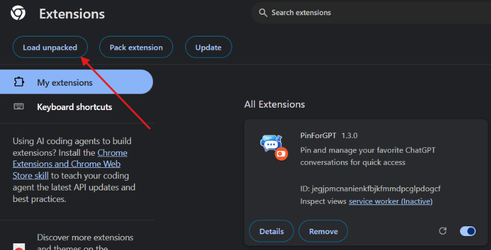

### Step 4 — Load the extracted extension

1. On the Extensions page, click **Load unpacked**.
2. In the file picker, find the permanent folder from Step 2.
3. Select **the folder containing `manifest.json`**, not the ZIP file and not its parent folder.
4. Confirm the selection.
5. You should now see **PinForGPT** among your installed extensions.

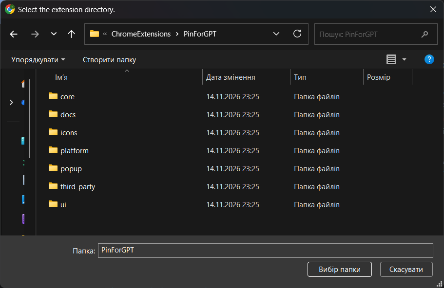

### Step 5 — Pin it and try it

1. Click Chrome's **Extensions** puzzle-piece button near the address bar.
2. Find **PinForGPT** and click the **pin** control so its icon stays visible on your toolbar.
3. Go to **https://chatgpt.com/**, or refresh any ChatGPT tabs already open.
4. Open the popup with the PinForGPT toolbar icon. If you do not see the icon, follow the illustrated [How to open the popup](#how-to-open-the-popup) instructions.
5. Save a conversation using its `…` menu or the popup's **Add current chat** button.

You're ready to use PinForGPT!

> [!TIP]
> For more information about Chrome's manual installation flow, see [Chrome's official “Load an unpacked extension” guide](https://developer.chrome.com/docs/extensions/get-started/tutorial/hello-world#load-unpacked).

## 7. Updating PinForGPT without losing Favorites

**Important: updating an unpacked extension is a manual process.** Chrome will not automatically replace the files you downloaded from GitHub.

The safest approach is to **keep using the same extension folder and browser profile**. Do **not** remove the existing extension just to update it.

### Step 1 — Make a backup first

1. Open your currently installed PinForGPT popup.
2. Go to **Data** → **Export to JSON**.
3. Confirm that the backup file was downloaded successfully and keep it in a safe location.

Even if the update normally preserves data, this takes the risk out of an unexpected problem.

### Step 2 — Download and unpack the new version

1. Visit **[PinForGPT Releases](https://github.com/TheOnefor/PinForGPT/releases/latest)**.
2. Download the new extension ZIP under **Assets**.
3. Extract it to a **temporary folder** first.
4. Open the extracted folder and locate the new `manifest.json`.

### Step 3 — Replace the files in the *existing* folder

1. Find the folder you originally selected with **Load unpacked** when installing PinForGPT.
2. Keep that folder **in the same location**, with the same name and path.
3. Copy the **contents** of the newly extracted extension folder into the existing one, replacing old files when prompted.
4. Make sure the result is still a single extension folder containing `manifest.json` directly — **not** a folder nested inside another copy of itself.

**Do not click Remove in Chrome's Extensions page. Do not use Load unpacked again for this update.** Removing or reinstalling an unpacked extension under a different identity can separate the new installation from the previous local data.

### Step 4 — Reload the extension and ChatGPT

1. Return to **`chrome://extensions`**.
2. Find the existing **PinForGPT** card.
3. Click its **Reload** (circular-arrow) control.
4. Refresh **all open ChatGPT tabs**, so the updated content scripts run in those pages.
5. Open the PinForGPT popup and confirm the displayed version is the one you installed.

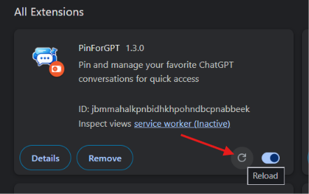

### Step 5 — Verify your data

1. Open **Favorites** in the popup.
2. Confirm your saved chats are still there and their titles look correct.
3. Open one of them and check the sidebar integration.
4. Keep the JSON backup until you're satisfied everything works.

**If the list appears empty:** check that you are using the **same Chrome profile** and reloaded the **existing extension**, rather than installing a second copy from another folder. If necessary, use **Data → Import JSON** to restore the saved list from your backup, choosing **Replace** only when you intend to overwrite the current list.

## 8. Troubleshooting

| Problem | What to try |
| --- | --- |
| **“Manifest file is missing” during installation** | Select the extracted folder containing `manifest.json` directly, not the ZIP or the parent folder. |
| **PinForGPT doesn't appear in ChatGPT's sidebar** | Make sure the extension is enabled; reload it in `chrome://extensions`, then refresh ChatGPT. A recent ChatGPT redesign may require a PinForGPT update. The popup may still work. |
| **The popup works but the Add to favorites menu item is missing** | Refresh ChatGPT and try another supported conversation. ChatGPT may have changed its native menus. |
| **I see `*star:r*` in a title instead of an icon** | Refresh the ChatGPT page and confirm PinForGPT is enabled. The code is part of the original title, so it remains visible when decoration is not active. |
| **“Add current chat” is unavailable** | Open a supported ChatGPT conversation in the active tab. The button is not intended for unrelated websites or pages without a supported conversation URL. |
| **My Favorites disappeared after reinstalling** | Confirm the browser profile and extension installation. If the previous installation had a different identity, use your exported JSON backup to restore the list. |
| **A chat opens in a new tab from the popup** | This is expected behavior, not a bug. |
| **My renamed chat has an old title in Favorites** | Refresh ChatGPT and the popup. Titles update on a best-effort basis; multiple open tabs can occasionally cause a stale title to be saved. |

If a problem persists, please [open a GitHub issue](https://github.com/TheOnefor/PinForGPT/issues) with your browser version, PinForGPT version, steps to reproduce, and a screenshot **with personal information removed**. Do not include session tokens, passwords, or unredacted JSON backups.

## 9. Credits and licensing

- **PinForGPT** is an independent, unofficial community project. It is **not affiliated with OpenAI**.
- Interface icons use [Lucide](https://lucide.dev/), with required notices bundled in [`third_party/lucide/LICENSE`](third_party/lucide/LICENSE) (ISC/MIT as applicable).
- For source code, current releases, and issue reports, visit the [PinForGPT repository](https://github.com/TheOnefor/PinForGPT).

---

**PinForGPT helps you find the conversations worth keeping — without giving up ChatGPT's own interface.**
